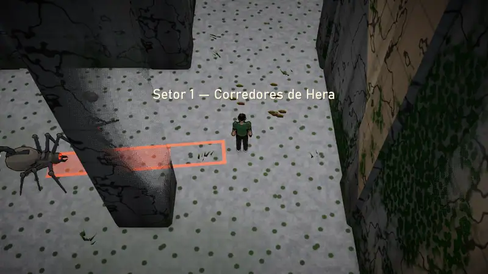
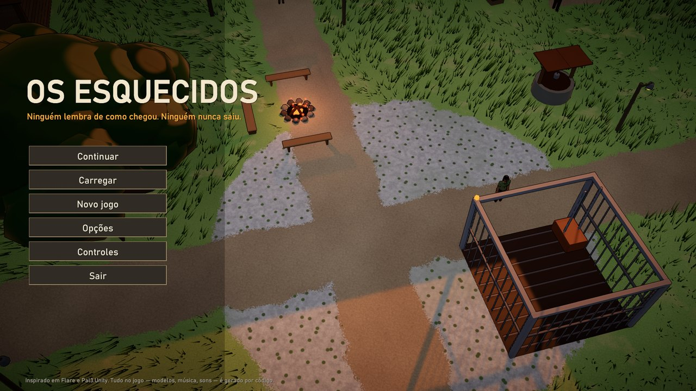
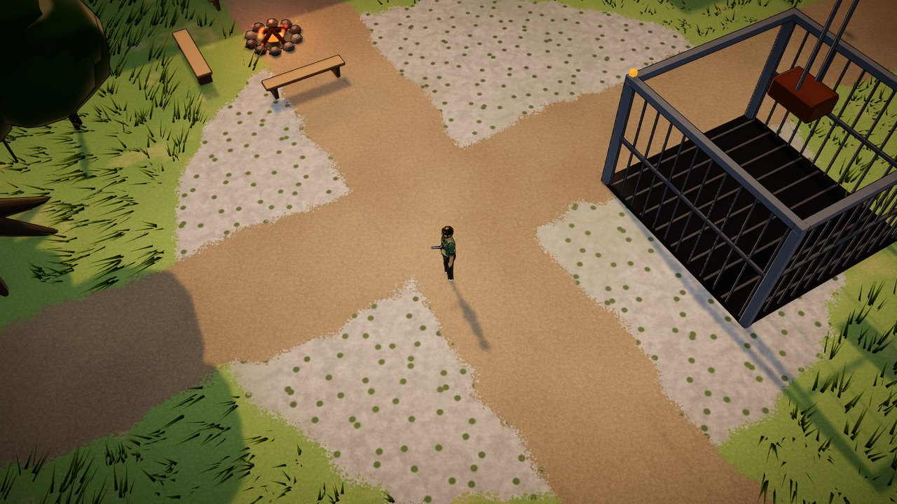
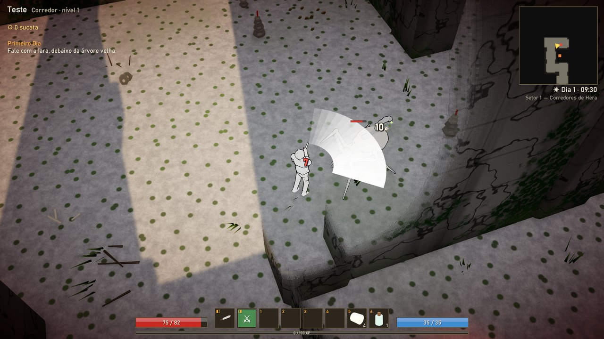
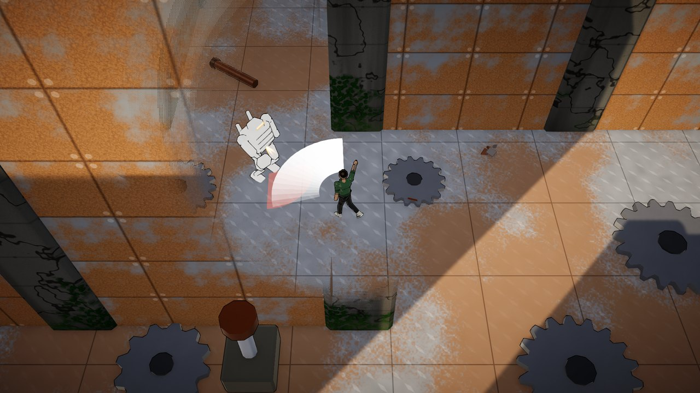
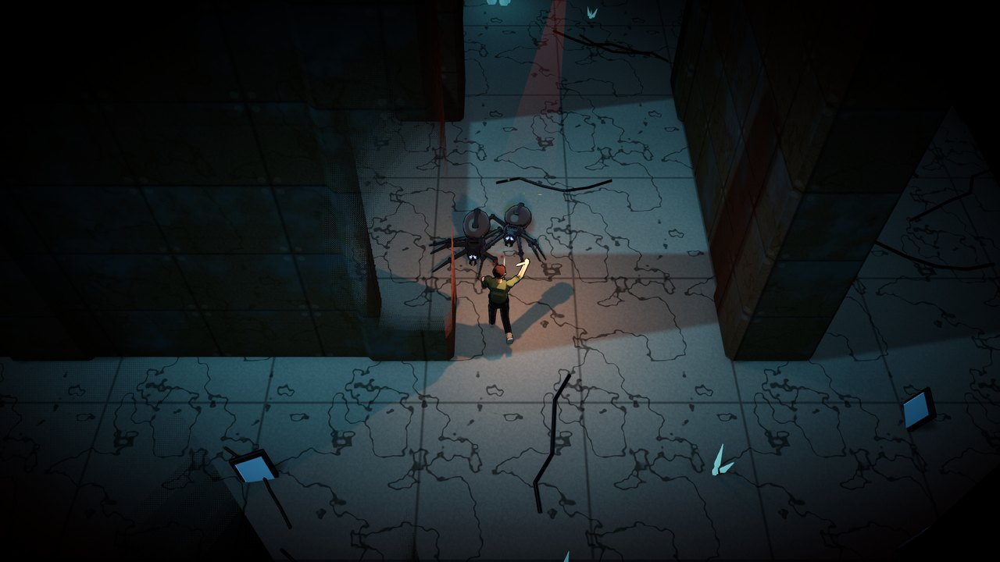
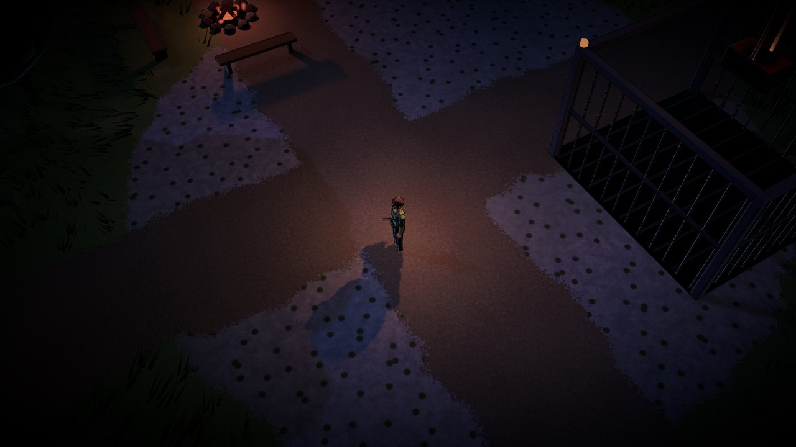

# Os Esquecidos



RPG de ação distópico no estilo de Maze Runner. Inspirado no **Flare** (jogabilidade: atributos, classes, poderes, loot com afixos, missões por status) e principalmente no **Pal3.Unity** (arquitetura: núcleo em C# puro, comandos e executores, roteiros como sequência de comandos, objetos de cenário com estado). Nada de código ou arte desses projetos foi copiado.

Você acorda num elevador de carga que sobe até o **Pátio**, um jardim cercado por muros de 24 m. Do lado de fora fica o **Labirinto**: os muros mudam a cada noite, os portões fecham ao anoitecer e os **Tecelões** saem para caçar.

Tudo no jogo é gerado por código: modelos, animação, shaders, texturas, música e efeitos sonoros. Não há nenhum arquivo de arte ou de áudio no projeto.

> **English:** *The Forgotten* is a dystopian action RPG in the spirit of Maze Runner, made entirely in code (models, animation, shaders, music and sound). The game is fully playable in English: pick it in **Options → Display → Language**, or it starts in English on systems that aren't set to Portuguese.

## Baixar e jogar

Baixe o zip para Windows na página de [Releases](https://github.com/PauloMatiasxvs/os-esquecidos/releases/latest), extraia e abra `Os Esquecidos.exe`. O Windows pode avisar que o programa não é assinado: clique em **Mais informações → Executar assim mesmo**.

Requisitos: Windows 10 ou 11 de 64 bits e placa de vídeo com DirectX 11 ou 12.

| | |
|---|---|
|  |  |
|  |  |
|  |  |

## Controles

| Comando | Ação |
|---|---|
| Clique esquerdo | Andar; em inimigo, atacar (segure para continuar); em gente, conversar; em item, pegar |
| W A S D | Andar direto |
| Shift + clique | Atacar parado na direção do cursor |
| Clique direito / 1–6 | Poderes e itens da barra |
| Espaço | Rolamento |
| F | Interagir com o que estiver perto |
| Q / E, roda do mouse | Girar e aproximar a câmera |
| I, C, K, J, M | Mochila, personagem, poderes, diário, mapa |
| F5 / F9 / Esc | Salvar / carregar / pausa |

Todas as teclas podem ser trocadas em **Opções → Teclas**. Controle de videogame também funciona.

## O que tem

- 3 classes (Corredor, Guardião, Remendeiro), 24 poderes de classe com ranks, 97 itens e 28 afixos de loot
- O Pátio, 5 setores de labirinto que mudam todo dia e o Laboratório; 23 tipos de inimigos, 6 deles chefes
- Ciclo de dia e noite: os portões fecham às 19h30, os muros andam de madrugada e os Tecelões Noturnos saem
- 8 personagens, 13 missões, 18 registros escondidos nos terminais e dois finais
- 3 espaços de salvamento, salvamento automático ao voltar ao Pátio
- Opções de som, resolução, tela cheia, qualidade gráfica (baixa, média, alta), tamanho do texto, teclas e idioma (português e inglês)

## Estrutura

| Parte | O que é |
|---|---|
| `Assets/Scripts/Esquecidos.Nucleo` | Regras do jogo em C# puro, sem Unity: simulação a 60 Hz, IA, combate, poderes, loot, inventário, missões, roteiros, gerador de labirinto, Pátio, ciclo dia/noite, salvamento e tradução |
| `Assets/Resources/Dados`, `Roteiros` | Conteúdo em texto: 3 classes, 24 poderes de classe, 97 itens, 28 afixos, 23 inimigos (6 chefes), 8 NPCs, 13 missões, 6 setores, 18 registros, história com 2 finais |
| `Assets/Resources/Traducoes/en` | A tradução para o inglês: cada frase em português seguida da versão em inglês |
| `Assets/Scripts/Motor` | Construtor de malhas, texturas de ruído, materiais, entrada com teclas trocáveis, síntese de som e música generativa |
| `Assets/Scripts/Esquecidos.Jogo` | Cena 3D, personagens e bichos animados, câmera, controle, efeitos, áudio, interface e menus |
| `Assets/Resources/Shaders` | Toon com contorno, muro triplanar com hera e ferrugem, chão, grama com vento, céu e partículas (URP) |

## Testes

```powershell
cd testes
dotnet test
```

190 testes xUnit. Entre eles:

- a história principal inteira, do caixote até os dois finais, com as três classes, pelos mesmos caminhos do jogador (conversa, portão, alavanca, chefe, marco, entrega)
- o labirinto: 8 sementes por setor, com toda célula alcançável mesmo com todos os muros móveis erguidos
- o ritmo do combate: bicho do primeiro setor cai em 2 a 4 golpes no nível 1
- a tradução: toda frase que o jogador lê tem versão em inglês, com os mesmos `{0}` do original

O núcleo compila como .NET Standard 2.1 / C# 9, igual ao Unity.

O executável também tem modos que jogam sozinhos e tiram fotos da tela:

```powershell
& ".\dist\OsEsquecidos\Os Esquecidos.exe" --campanha
```

| Modo | O que faz |
|---|---|
| `--captura` | Passeio pelas telas: menu, criação, abertura, Pátio, conversa, janelas, setor, combate, noite, laboratório, morte, pausa e opções |
| `--campanha` | A história principal inteira com o jogo rodando: os 5 setores, os 6 chefes, a noite com os muros andando e os dois finais |
| `--fotos` | As fotos deste README, sem interface por cima |
| `--video` | Quadros numerados de uma briga, para virar animação |

Junte `--idioma=en` para rodar em inglês e `--saida=pasta` para escolher onde salvar. Nesses modos o jogo fica mudo, a janela vai para fora da tela sem roubar o teclado, e nada é gravado por cima do jogo salvo ou das opções. O relatório (`relatorio.txt`) lista erros do log, tempo de carga de cada mapa e quadros por segundo.

## Gerar o executável

Projeto Unity 6.6 (URP). Pela linha de comando, sem abrir o editor:

```powershell
& "C:\Program Files\Unity\Hub\Editor\6000.6.5f1\Editor\Unity.exe" -batchmode -quit -projectPath . -executeMethod Esquecidos.Editor.Construcao.Windows
```

Ou, com o projeto aberto no editor, menu **Os Esquecidos → Gerar executável Windows**. O jogo sai em `dist/OsEsquecidos`.

## Licença

MIT — veja [LICENSE](LICENSE).
